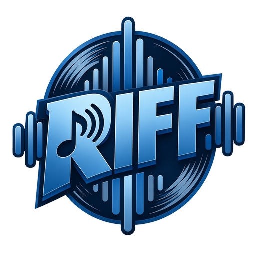
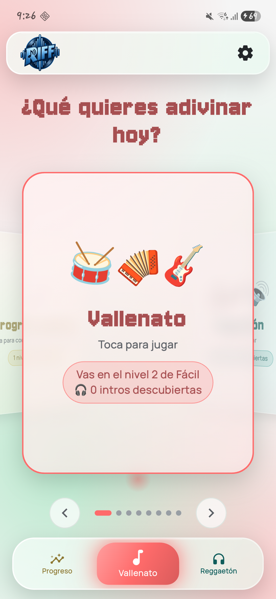
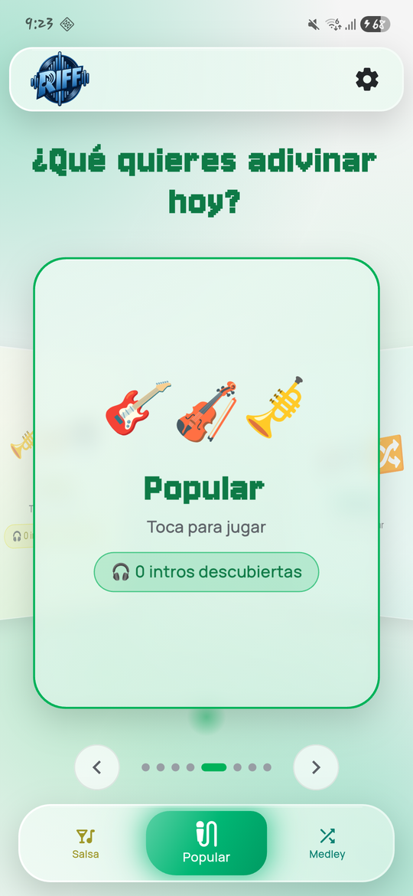
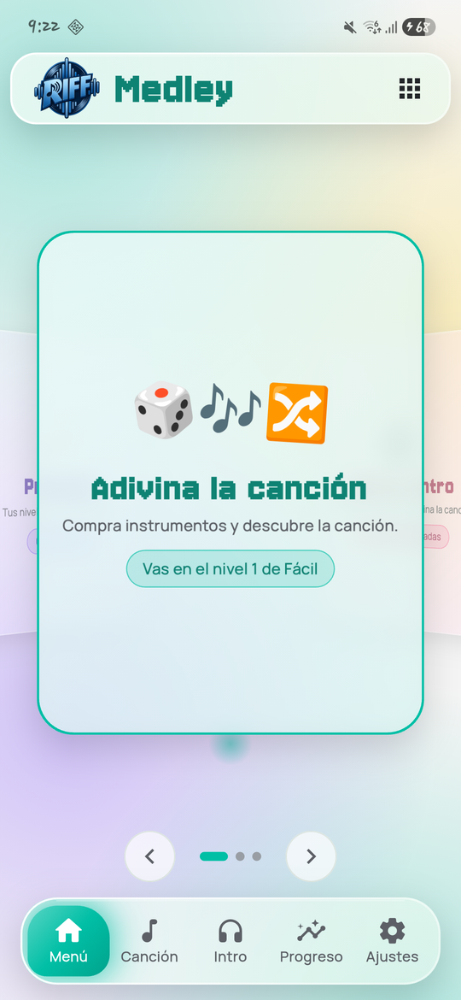
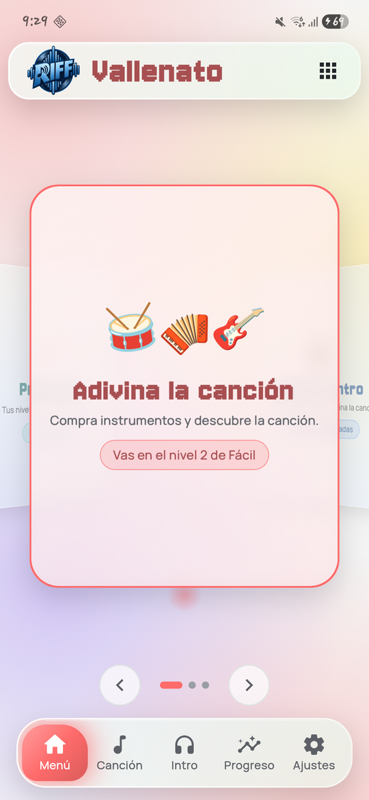
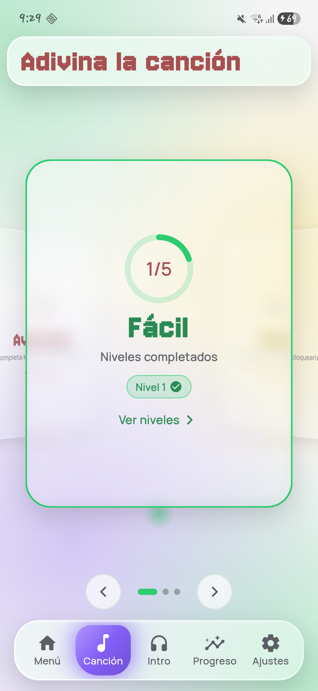
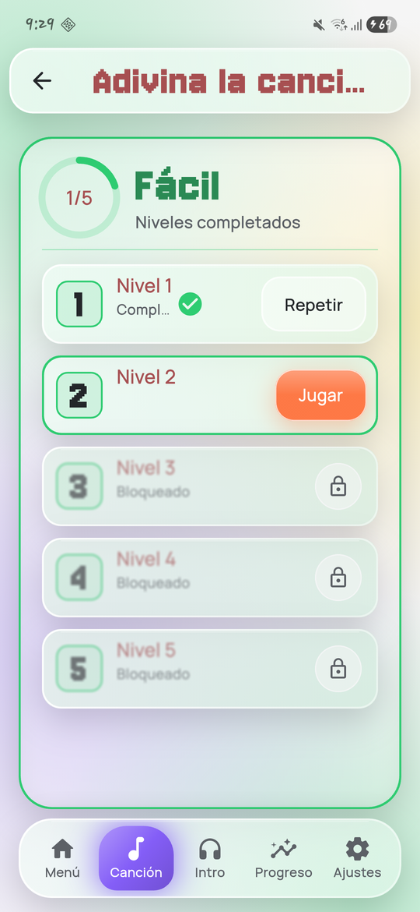
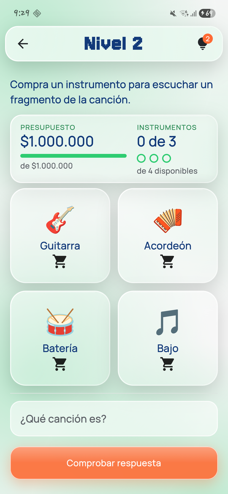
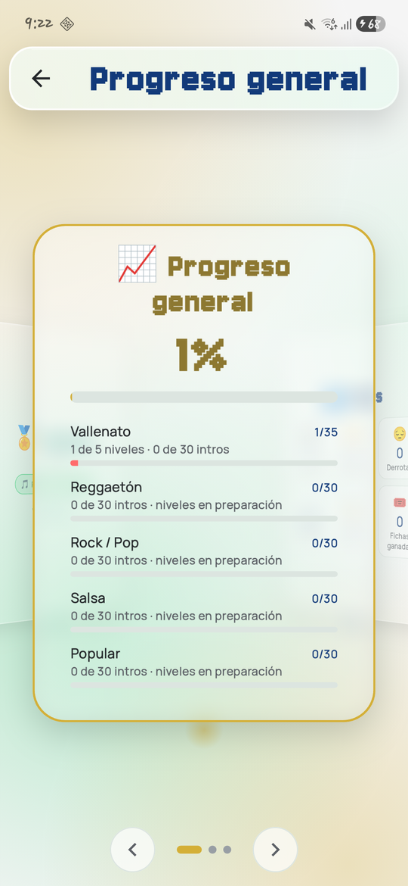
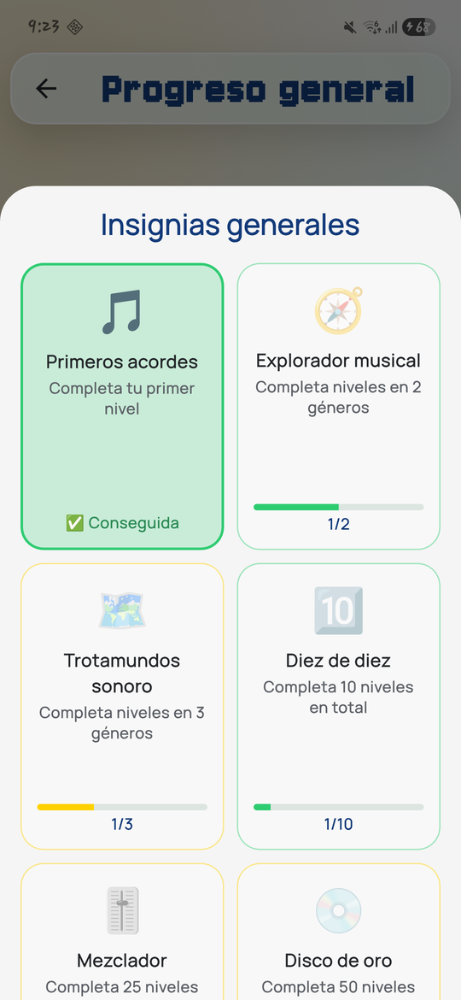

# 🎵 RIFF

  

<h3 align="center">¿Puedes reconocer una canción escuchando sus instrumentos?</h3>

RIFF es un juego musical para dispositivos Android en el que tendrás que descubrir canciones utilizando únicamente tu oído. Escucha diferentes instrumentos, administra tu presupuesto, reconoce melodías y demuestra cuánto sabes de música.

**Escucha. Descubre. Adivina.**

---

## 📥 Descargar RIFF

RIFF todavía no está publicado en las tiendas oficiales. Mientras tanto, puedes descargar e instalar la última versión directamente desde GitHub.

  <a href="https://github.com/Paulo1426/RIFF/releases/download/apk-latest/app-release.apk">
    <strong>⬇️ DESCARGAR RIFF PARA ANDROID (APK)</strong>
  </a>

  
   
  <em>Escanea el código QR para descargar el APK</em>

### Jugar en el navegador

También puedes jugar RIFF desde el navegador, en PC o en el móvil, sin instalar nada:

  <a href="https://riff-adivina-la-cancion.web.app">
    <strong>🌐 JUGAR RIFF EN LA WEB</strong>
  </a>

La versión web no incluye modo offline ni recordatorios.

### ¿Cómo instalarlo?

1. Descarga el archivo APK desde tu dispositivo Android.
2. Abre el archivo descargado.
3. Si Android lo solicita, permite la instalación desde esa fuente.
4. Completa la instalación y disfruta del juego.

El archivo se actualiza con las nuevas versiones del proyecto. Consulta también las [últimas versiones de RIFF](https://github.com/Paulo1426/RIFF/releases/tag/apk-latest).

---

## 🎮 ¿Qué es RIFF?

RIFF es un juego de adivinanza musical que reúne diferentes géneros y estilos musicales en una sola experiencia.

El objetivo es descubrir canciones escuchando fragmentos de sus instrumentos por separado, tomando decisiones y utilizando tu presupuesto de manera estratégica.

El juego cuenta con cinco géneros musicales:

| Género | Descripción |
|---|---|
| 🪗 Vallenato | Acordeones, melodías y sonidos tradicionales. |
| 🎤 Reggaetón | Ritmos urbanos y sonidos electrónicos. |
| 🎸 Rock / Pop | Guitarras, melodías y ritmos modernos. |
| 💃 Salsa | Ritmos latinos y sonidos característicos del género. |
| 🎶 Popular | Rancheras y música popular colombiana. |

Además, encontrarás **Medley**, un modo que combina canciones e intros de los cinco géneros.

---

## 🕹️ Modo principal: Adivina la canción

Cada partida es un desafío en el que tendrás que descubrir una canción escuchando sus instrumentos.

### 1. Elige una dificultad

RIFF cuenta con tres dificultades:

- Fácil.
- Media.
- Avanzada.

Cada dificultad tiene cinco niveles por género. Para desbloquear la siguiente dificultad debes completar los cinco niveles de la anterior.

El orden de las canciones se mezcla para cada jugador, haciendo que la experiencia sea diferente.

### 2. Administra tu presupuesto

Al comenzar cada partida recibes **$1.000.000** para comprar tres de los cuatro instrumentos disponibles.

Los precios permanecen ocultos hasta realizar cada compra. Los instrumentos tienen precios de $300.000 o $400.000, y las tres compras siempre suman exactamente $1.000.000.

### 3. Escucha los instrumentos

Cada instrumento comprado permite escuchar su pista musical de manera individual o combinada con las demás.

Los fragmentos de los niveles normales duran 30 segundos.

Dependiendo del género, encontrarás diferentes instrumentos melódicos:

- **Vallenato:** acordeón.
- **Reggaetón:** sintetizador.
- **Rock / Pop:** teclado.
- **Salsa:** metales.
- **Popular:** trompeta.

La batería, el bajo y la guitarra acompañan los diferentes géneros.

### 4. Descubre la melodía

Después de realizar las tres compras, el juego determina dónde se encuentra la melodía principal. Existen dos posibilidades:

- **¡Encontraste la melodía!** Si está en uno de los instrumentos que compraste, se desbloquean los cuatro instrumentos y la mezcla instrumental completa.
- **La melodía está en el instrumento que no compraste.** Tendrás que intentar reconocer la canción utilizando únicamente las tres pistas disponibles.

La ubicación de la melodía se determina aleatoriamente en cada partida.

### 5. Adivina la canción

Cuando creas saber qué canción estás escuchando, escribe su nombre. Si aciertas:

- Completarás el nivel.
- Se guardará tu progreso.
- Desbloquearás la grabación original con voz.
- Podrás escuchar la canción completa desde el reproductor del juego.

> **¡Cada partida puede ser diferente!** Los precios y la ubicación de la melodía cambian cuando vuelves a jugar un nivel.

---

## 🎧 Modo: Adivina la intro

¿Puedes reconocer una canción escuchando solamente sus primeros segundos?

En este modo encontrarás una colección de introducciones musicales de los diferentes géneros.

### ¿Cómo funciona?

- Cada intro tiene una duración de 30 segundos.
- Cada carta cuesta una moneda.
- Las canciones pendientes de adivinar aparecen primero en la colección.
- Las canciones descubiertas quedan guardadas y organizadas alfabéticamente.

### ¿Cómo conseguir monedas?

Cada nivel que completes por primera vez te recompensa con monedas según su dificultad:

| Dificultad | Monedas |
|---|---|
| Fácil | 2 |
| Media | 3 |
| Avanzada | 4 |

Las monedas se organizan por género musical, cada uno con su propio símbolo y saldo. También recibirás un bono inicial de 10 monedas para comenzar a disfrutar de este modo.

Medley también tiene su propia economía de monedas: permite conseguir 135 monedas y utilizarlas para descubrir sus intros. Además, puedes utilizar las monedas del género correspondiente a cada canción o introducción.

---

## 🎲 Modo especial: Medley

Medley reúne los cinco géneros musicales de RIFF en una experiencia aleatoria.

En lugar de jugar exclusivamente con un género, aquí las canciones y las intros pueden pertenecer a cualquiera de los cinco estilos.

### ¿Qué encontrarás en Medley?

- 15 niveles por dificultad.
- Canciones seleccionadas aleatoriamente entre los cinco géneros.
- Hasta 100 intros diferentes.
- Progreso independiente.
- Monedas propias para descubrir introducciones.

El orden de las canciones se genera para cada jugador y se conserva su progreso.

Es una excelente opción si quieres poner a prueba tus conocimientos musicales sin limitarte a un solo género.

---

## 🏆 Salas multijugador

¡La música también se disfruta en compañía!

RIFF incorpora un modo de salas en el que pueden participar hasta **10 jugadores**.

Puedes crear o unirte a una sala seleccionando:

- Un género musical específico.
- 🎲 Modo aleatorio, con canciones e intros de cualquiera de los cinco géneros.

Las salas cuentan con fichas para participar y estadísticas propias. Cada cuenta registrada recibe 20 fichas de bienvenida.

También podrás consultar tus estadísticas de partidas jugadas, victorias, podios y otras actividades.

---

## 🏅 Insignias y logros

Demuestra tu progreso y consigue reconocimientos mientras juegas. RIFF cuenta con dos categorías de insignias:

- **Insignias por género:** cada género tiene sus propios reconocimientos, que podrás conseguir completando desafíos, descubriendo canciones y participando en salas.
- **Insignias generales:** existen 20 insignias generales que reconocen tus avances en los diferentes géneros y en las salas.

Cuanto más juegues, más oportunidades tendrás de completar tu colección.

---

## ✨ Características principales

- **Cinco géneros musicales:** Vallenato, Reggaetón, Rock / Pop, Salsa y Popular.
- **Modo Medley:** combina canciones e intros de todos los géneros.
- **Tres dificultades:** Fácil, Media y Avanzada.
- **Compra de instrumentos:** administra un presupuesto de $1.000.000 en cada partida.
- **Reproducción musical:** escucha pistas individuales y mezclas instrumentales.
- **Adivina la intro:** descubre canciones escuchando sus introducciones.
- **Salas multijugador:** comparte desafíos musicales con hasta 10 jugadores.
- **Insignias y logros:** consigue reconocimientos por tus avances.
- **Estadísticas:** consulta tu rendimiento general y por género.
- **Progreso guardado:** conserva tus niveles, canciones descubiertas y logros.
- **Inicio de sesión:** accede con correo electrónico, Google o mediante el modo invitado.
- **Requiere conexión a internet:** puedes repetir niveles completados y volver a escuchar las intros que ya desbloqueaste; las canciones desbloqueadas se guardan en la caché del teléfono para escucharlas más rápido (en la web no se guarda nada).
- **Diseño moderno:** interfaz Liquid Glass, iconos musicales, animaciones, transiciones y música de fondo en los menús.

---

## 📱 Experiencia visual

RIFF cuenta con una interfaz moderna, animaciones y una identidad visual inspirada en la música.

<table>
<tr><td align="center"> <b>Elige tu género</b></td><td align="center"> <b>Cinco géneros y Medley</b></td><td align="center"> <b>Medley</b></td></tr>
<tr><td align="center"> <b>Menú de cada género</b></td><td align="center"> <b>Tres dificultades</b></td><td align="center"> <b>Niveles por dificultad</b></td></tr>
<tr><td align="center"> <b>Compra de instrumentos</b></td><td align="center"> <b>Progreso por género</b></td><td align="center"> <b>Insignias</b></td></tr>
</table>

---

## 📲 Plataforma

Actualmente, RIFF está desarrollado para dispositivos **Android**.

---

## 🛠️ Para desarrolladores

¿Quieres conocer cómo está construido RIFF, qué tecnologías utiliza o cómo ejecutar el proyecto? La documentación técnica es un documento local del proyecto y no se publica en este repositorio.

---

## 🎼 ¡Pon a prueba tu oído musical!

No necesitas ser músico para jugar. Solo necesitas prestar atención, reconocer las melodías y tomar buenas decisiones.

Descubre canciones, explora diferentes géneros, consigue insignias y demuestra tus habilidades musicales.

<h3 align="center">🎵 ESCUCHA. DESCUBRE. ADIVINA.</h3>
<h2 align="center">Bienvenido a RIFF.</h2>
